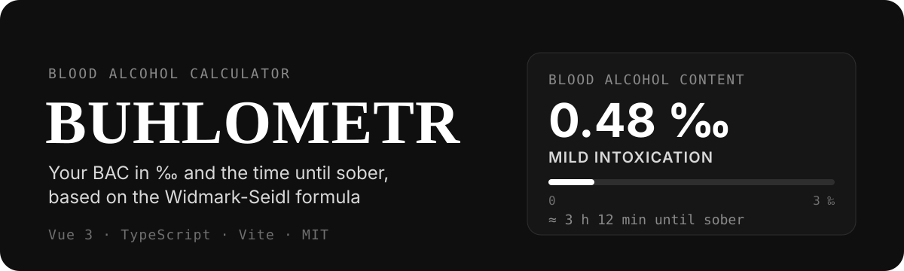
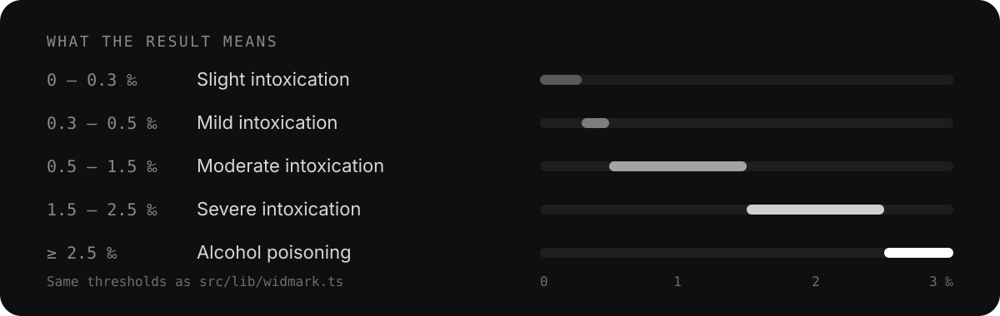

<p align="center">
  
</p>

<p align="center"><b>English</b> · <a href="README.ru.md">Русский</a></p>

<p align="center">
  <a href="https://darkwhitezero.github.io/alcohol-calculator/"><b>Open the live demo</b></a>
</p>

<p align="center">
  <a href="https://github.com/darkwhitezero/alcohol-calculator/stargazers"></a>
  <a href="./LICENSE"></a>
  <a href="https://vuejs.org/"></a>
  <a href="https://www.typescriptlang.org/"></a>
</p>

**Buhlometr** (from Russian *bukhlo*, slang for booze, plus *-meter*) is a small web calculator.
Tell it who you are and what you drank, and it estimates your blood alcohol content in per mille (‰)
and roughly how long until it's back to zero. The math is the Widmark formula with Seidl's correction
for height and weight.

The interface is in Russian. It's a handful of number fields, so a browser translator handles it fine.

> [!WARNING]
> This is an estimate, not a medical or legal tool. Never drive after drinking, even if the calculator shows 0.

<p align="center">
  
</p>

## What it does

- Calculates BAC from sex, weight and height.
- Takes stomach contents into account: empty, a snack, or a full meal.
- Handles several drinks at once. Pick a preset (beer, wine, vodka and so on) or enter your own volume and ABV.
- Shows the result on a scale of intoxication levels and estimates the time until sober.
- Points at the exact field when an input is wrong and says what's wrong with it.
- Remembers the form between visits (localStorage).
- Shares a result as text or as a link that restores everything you entered.

## How the number is calculated

Grams of pure alcohol:

```text
A = volume_ml × (abv / 100) × 0.789
```

Blood alcohol content, Widmark:

```text
BAC ≈ A / (r × m) − β × t
```

| Symbol | Meaning |
| --- | --- |
| `A` | grams of ethanol, minus 10% for a snack or 20% for a full meal (absorption deficit) |
| `m` | body weight, kg |
| `r` | distribution factor. Seidl's version computes it from sex, weight and height |
| `β` | elimination rate, about 0.15 ‰ per hour on average |
| `t` | hours since you started drinking |

All of this lives in [`src/lib/widmark.ts`](src/lib/widmark.ts) and is covered by Vitest tests.

### What the result means

<p align="center">
  
</p>

| Per mille | State |
| --- | --- |
| `0 ‰` | Sober |
| `< 0.3 ‰` | Slight intoxication |
| `0.3 to 0.5 ‰` | Mild intoxication |
| `0.5 to 1.5 ‰` | Moderate intoxication |
| `1.5 to 2.5 ‰` | Severe intoxication |
| `2.5 ‰ and above` | Alcohol poisoning |

Legal driving limits depend on the country. The app is written for Russia, where the limit is 0.3 ‰.

## Run it locally

```bash
npm install
npm run dev        # dev server with hot reload
npm run build      # production build into dist/
npm run preview    # preview the production build
npm run test       # unit tests (Vitest)
npm run typecheck  # type check
```

Stack: Vue 3 (Composition API, `<script setup>`), TypeScript in strict mode, Vite, Vitest.

## Project layout

```text
index.html          entry point
src/
  main.ts           app bootstrap
  App.vue           root component
  lib/              pure logic without Vue, covered by tests:
                    widmark.ts (BAC), validation.ts (form checks),
                    types, constants, localStorage, sharing
  composables/      form state (useCalculatorForm) and the animated
                    per mille counter (useCountUp)
  components/       UI components
  styles/           global styles and self-hosted fonts (black and white theme)
  assets/           background, mascot animation (transparent WebP), fonts (woff2)
public/             favicon, OG preview
docs/               README images
```

## Disclaimer

The numbers are approximate. The formula doesn't know about your metabolism, health, medication,
how tired you are, or a dozen other things that matter. The result has no legal weight and can't be
used to argue with a breathalyzer reading.

If Buhlometr was useful or just made you smile, a star helps other people find it.

## License

[MIT](LICENSE)
